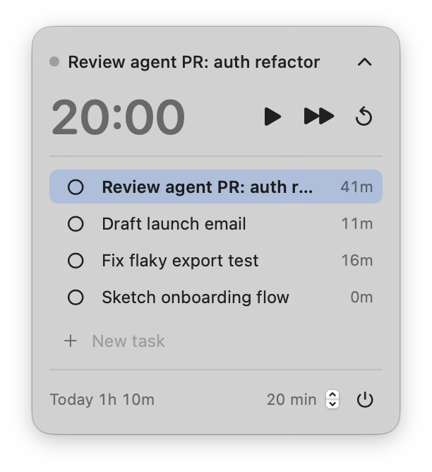

# Cronom

A tiny floating macOS timer for timeboxing tasks, with every minute logged to SQLite.

It's a pomodoro timer adapted for async work with AI agents: kick something off,
work on it until you hit a wall (or the clock runs out), then jump to the next task
while the agent grinds. Cronom keeps the countdown honest and records where your
time actually went.



## Features

- Small borderless panel that floats above other windows and follows you across
  every Space, including full-screen apps. It never steals focus unless you type
  into it.
- Countdown per task, 20 minutes by default (adjustable in the footer, remembered).
- Alarm (the system "Glass" sound) when time runs out.
- Time is attributed to the active task only while the timer runs; sleeping the
  Mac pauses it.
- No Dock icon, no menu bar clutter.

## Usage

| Action | How |
| --- | --- |
| Add a task | Type in **New task** and press Enter (field stays focused for more) |
| Start / pause | ▶ / ⏸ |
| Next task | ⏭ — goes to the next open task, wrapping around. If the clock was live, a fresh countdown starts |
| Switch task | Click it |
| Reorder | Drag a task row |
| Mark done | Click the circle (done tasks are hidden) |
| Rename / edit today's time / delete | Right-click a task |
| Timer length | Stepper in the footer |
| Collapse to just the timer | Chevron in the header |
| Move the panel | Drag anywhere that isn't a task row |
| Quit | ⏻ in the footer, or ⌘Q while the panel is focused |

**Edit time today** sets the task's total for today. It accepts `45`, `45m`, `1h`,
`1h 30m`, or `1:30` (bare numbers are minutes).

## Build

Requires macOS 14+ and the Swift toolchain (Xcode or the Command Line Tools).

```sh
./build.sh            # builds build/Cronom.app
./build.sh --run      # build and (re)launch
./build.sh --install  # build and copy to /Applications
```

`build.sh` falls back to `/Library/Developer/CommandLineTools` if Xcode's license
hasn't been accepted. The app is ad-hoc signed.

## Data

Everything lives in `~/Library/Application Support/Cronom/cronom.sqlite`:

- `tasks(id, name, done, created_at, position)`
- `segments(id, task_id, start, end, manual)` — one row per stretch of running time,
  as unix seconds. Rows with `manual = 1` are corrections from **Edit time today**;
  they're dated when made and their `end - start` may be negative.

Time per task today:

```sh
sqlite3 ~/Library/Application\ Support/Cronom/cronom.sqlite "
  SELECT t.name, ROUND(SUM(s.end - s.start) / 60) AS minutes
  FROM segments s JOIN tasks t ON t.id = s.task_id
  WHERE s.start >= strftime('%s', 'now', 'start of day', 'localtime', 'utc')
  GROUP BY t.id ORDER BY minutes DESC;"
```

Set `CRONOM_DB=/path/to/other.sqlite` to run against a different database (handy for
testing). Settings (timer length, active task, panel position) are in `UserDefaults` under
`com.fletchgraham.cronom`.

## Layout

```
Sources/Cronom/
  main.swift         app delegate + floating NSPanel
  ContentView.swift  SwiftUI UI, drag-to-reorder, inline editing
  TimerModel.swift   timer state machine and task actions
  Database.swift     SQLite wrapper and schema migrations (PRAGMA user_version)
```
